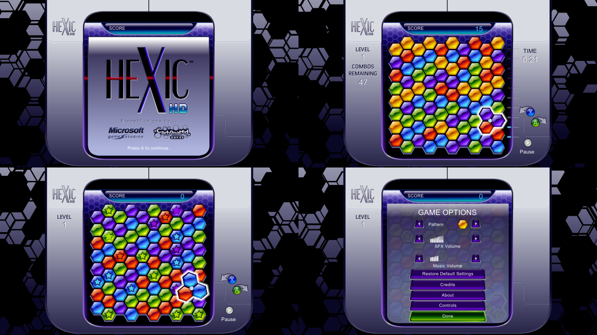

# Hexic HD Recompiled

A statically recompiled PC port of **Hexic HD** (Xbox Live Arcade, Carbonated Games / Microsoft, 2005). The game's
PowerPC code is translated ahead of time to C++ with the [ReXGlue SDK](https://github.com/rexglue/rexglue-sdk) and
compiled into a Windows program, so there is no CPU emulator; the console's graphics, audio and system calls are
reimplemented underneath, drawn with Direct3D 12.

## Status

Playable: the menus, Timed and Survival modes, pause, Game Options and the Tutorial. Shaders are precompiled and
load at startup, so nothing stutters while they compile. Not yet checked: the music and sound by ear, and Marathon
mode past the first levels.

**No game data is included**: the game's data and its original code are read from your own copy.

## Playing

You need **Windows 10 or 11 (64-bit)**, a graphics card with **Direct3D 12**, an Xbox controller, and your own
copy of **Hexic HD** from an Xbox 360 (the `584107D1...` package file from the console's
`Content\0000000000000000\584107D1\000D0000` folder, or that whole `584107D1` folder).

1. Download the latest release and unzip it anywhere.
2. Copy your package (or the `584107D1` folder) into the `game` folder.
3. Open **`hexic.exe`**. The first start unpacks the package in place; after that it starts straight away.

## Building

See [docs/PREP.md](docs/PREP.md) for the full log. In short, with Visual Studio 2026 Build Tools, LLVM (clang-cl)
and Ninja:

1. Clone the ReXGlue SDK at commit `c94f5eb`, apply `patches/rexglue-xbla-fixes.patch`, and build and install it
   (`tools\sdk_install.cmd`). Point `tools\env.cmd` at your SDK.
2. In `port/`, run `rexglue codegen hexic_manifest.toml` against your own unpacked `default.xex`, then build the
   `win-amd64-release` preset.
3. Run `tools\package.ps1` to make `dist\HexicHD`.

## Credits

- [ReXGlue SDK](https://github.com/rexglue/rexglue-sdk) by Tom Clay, built on the [Xenia](https://xenia.jp)
  project's work

This port's own code is under the [GPL-3.0](LICENSE). It is a fan project, not affiliated with or endorsed by
Microsoft. Hexic is a trademark of Microsoft. You need your own copy of the game.
